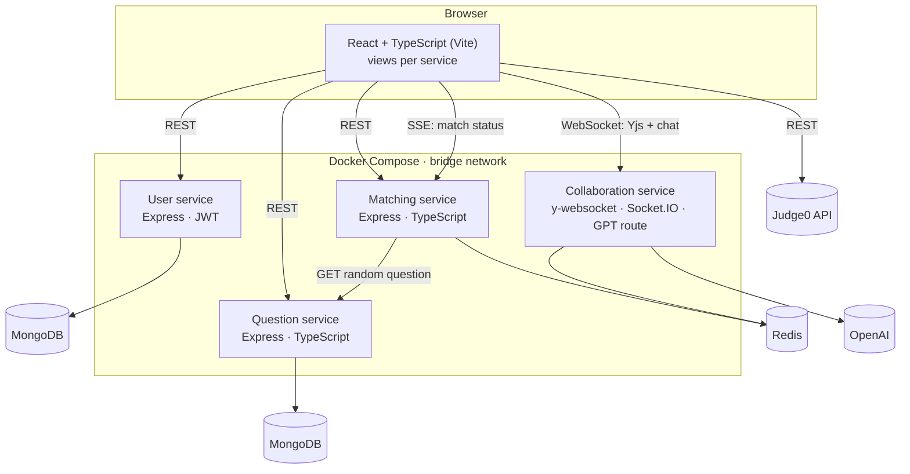

# PeerPrep: architecture

> [!NOTE]
> This architecture write-up was added by
> [Claude Opus 5.5](https://docs.anthropic.com/en/docs/claude-code) in Nov 2026 using my
> [agentic-repo-analysis](https://github.com/sp4ce-cowboy/agentic-workflows) skill, from the
> project's code, git history and the team's reports.

A technical write-up of PeerPrep, the NUS CS3219 team project (AY2024/25 Semester 1), from the
final code and the team's 58-page final report. Back to the [README](README.md).

**Contents:**
1. [Requirements](#1-requirements)
2. [System architecture](#2-system-architecture)
3. [Repository and workflow](#3-repository-and-workflow)
4. [The front end](#4-the-front-end)
5. [Matching](#5-matching)
6. [The collaboration session](#6-the-collaboration-session)
7. [Service-to-service communication](#7-service-to-service-communication)
8. [Deployment](#8-deployment)
9. [Decisions and trade-offs](#9-decisions-and-trade-offs)
10. [Timeline](#10-timeline)
11. [Next steps](#11-next-steps)

## 1. Requirements

The course specified four core services and a menu of nice-to-haves. The team chose five.

| | Requirement | What was built |
|---|---|---|
| F1 | User service | Sign-up, login with JWT, profiles, admin role |
| F2 | Matching service | Match two students by topic and difficulty within 30 s |
| F3 | Question service | A question bank with categories, difficulty and test cases; CRUD for admins |
| F4 | Collaboration service | A shared, real-time code editor for each matched pair |
| N1 | Communication | Chat within a session (Socket.IO) |
| N3 | Code execution | Run code in the browser's chosen language (Judge0) |
| N4 | Enhanced collaboration | Highlighting, autocomplete and execution for 8 languages; shared undo |
| N6 | Generative AI | GPT-4 review of a solution, with a fixed prompt |
| N7 | Cloud deployment | One Google Cloud VM, Nginx, managed MongoDB and Redis |

## 2. System architecture



- **Microservices with a database server per service**, for loose coupling: each service owns its
  store and its `.env`.
- **The exception:** matching and collaboration share Redis. A student is either queued or in a
  session, and neither needs durable storage, so one store keeps the two states consistent.
- **MVC inside each service:** models and controllers in the service, views in the shared front end,
  routes in between. Some services add adaptors between controllers and the database, and the
  collaboration service keeps its sessions in Redis rather than a model of its own.
- **Databases chosen against alternatives** in the report: MongoDB for questions (flexible schema,
  Mongoose, managed Atlas) over MySQL, PostgreSQL or Cassandra; Redis for matching (in-memory sorted
  sets and hashes, sub-millisecond reads) over RabbitMQ.

## 3. Repository and workflow

- **One monorepo** for all services: shared configuration, one place for CI and secrets, no
  submodules.
- **Branch protection** and a two-level branching flow: feature branches, each person branching off
  them, merged into `dev`; `dev` merged into `main` at each milestone, so `main` is always a working
  checkpoint.
- **Swappable services.** When the collaboration service needed a rewrite, the team swapped in a
  second implementation (`collab-service-2`) and later swapped the fixed original back, with no change
  elsewhere.

## 4. The front end

My part of the project. One React app holds every service's views:

```text
peerprep/frontend/src
├── api/          one typed client per service (axios)
├── views/
│   ├── UserServiceViews/        login, sign-up, profile, admin
│   ├── QuestionServiceViews/    question bank and form
│   ├── MatchingServiceViews/    matching page, session stub
│   └── CollabServiceViews/      the session: editor, chat, output, test cases
├── styles/App.css   the shared design system
└── App.tsx          routes for every service
```

- **Routing** ([`App.tsx`](https://github.com/sp4ce-cowboy/PeerPrep/blob/3b54cadfac2e6dd515097c149c4705e9c1cc6734/peerprep/frontend/src/App.tsx#L23-L55)): login, questions, matching, the session at
  `/collabFull/:sessionId`, profiles and an admin route.
- **One design system, in vanilla CSS** ([`App.css`](https://github.com/sp4ce-cowboy/PeerPrep/blob/3b54cadfac2e6dd515097c149c4705e9c1cc6734/peerprep/frontend/src/styles/App.css)): buttons, forms, cards, tables, the progress
  bar and the editor layout, shared by every view.
- **Not containerised:** unlike the services, the front end stays one Vite app, so the views share
  components and styling.

## 5. Matching

1. The student picks a topic and difficulty and submits
   ([`MatchingServiceMainView`](https://github.com/sp4ce-cowboy/PeerPrep/blob/3b54cadfac2e6dd515097c149c4705e9c1cc6734/peerprep/frontend/src/views/MatchingServiceViews/MatchingServiceMainView.tsx#L5-L91)).
2. The page starts a 30-second countdown with a progress bar, and follows the request's status as the
   matching service pushes it over server-sent events.
3. **The algorithm** (the matching service, in Redis): a request first joins a `topic:difficulty`
   queue, a sorted set ordered by time. After 15 seconds, `shiftQueue` moves it to a topic-only queue;
   after 15 more, `clearExpiredEntries` removes it. A hash tracks who is queued. All the operations
   are atomic.
4. **On a match**, the service asks the question service for a random question with that topic and
   difficulty ([`getRandomQuestionEndpoint`](https://github.com/sp4ce-cowboy/PeerPrep/blob/3b54cadfac2e6dd515097c149c4705e9c1cc6734/peerprep/backend/question-service/src/controllers/questionController.ts#L103-L169)),
   creates a session, and both students see **Go to Session**.

## 6. The collaboration session

The session view ([`CollabServiceIntegratedView`](https://github.com/sp4ce-cowboy/PeerPrep/blob/3b54cadfac2e6dd515097c149c4705e9c1cc6734/peerprep/frontend/src/views/CollabServiceViews/CollabServiceIntegratedView.tsx)) shows the question, the shared editor,
chat, the output and the test cases.

**Choosing the editor and the sync together.** In this service the editor and the synchronisation
are coupled, so they were compared as a pair:

| Editor | For | Against |
|---|---|---|
| **CodeMirror** (chosen) | Light and fast; language modes; hints and themes; a React wrapper (`react-codemirror2`) | No IntelliSense built in |
| Monaco | IntelliSense, rich language services | Heavy, slow to load |
| ProseMirror | CRDT-friendly, extensible | Built for documents: no syntax highlighting |

| Sync | For | Against |
|---|---|---|
| **WebSockets** via a server (chosen) | Scales from the server; hides peers' IP addresses; central traffic control | A little latency through the server |
| Peer to peer | Lower latency in small groups | Exposes IPs; each client manages every peer |

**How it fits together:**
- **Shared document** ([session set-up](https://github.com/sp4ce-cowboy/PeerPrep/blob/3b54cadfac2e6dd515097c149c4705e9c1cc6734/peerprep/frontend/src/views/CollabServiceViews/CollabServiceIntegratedView.tsx#L95-L110)): a `Y.Doc` per session, a
  `WebsocketProvider` for the session's room, and a `CodemirrorBinding` from y-codemirror that ties
  the Yjs text to the editor. Yjs is a CRDT, so concurrent edits merge without conflicts, and the
  undo history is shared. Leaving the session destroys the binding, the provider and the document.
- **Eight languages from one selector** ([`handleLangChange`](https://github.com/sp4ce-cowboy/PeerPrep/blob/3b54cadfac2e6dd515097c149c4705e9c1cc6734/peerprep/frontend/src/views/CollabServiceViews/CollabServiceIntegratedView.tsx#L124-L139)): each option is a
  Judge0 language ID (63 JavaScript, 50 C, 54 C++, 51 C#, 71 Python, 62 Java, 72 Ruby, 78 Kotlin)
  mapped to a CodeMirror mode, so highlighting and execution always agree. Switching reloads the
  mode without reloading the session.
- **Autocomplete** ([editor options](https://github.com/sp4ce-cowboy/PeerPrep/blob/3b54cadfac2e6dd515097c149c4705e9c1cc6734/peerprep/frontend/src/views/CollabServiceViews/CollabServiceIntegratedView.tsx#L280-L306)): a `keyup` listener opens CodeMirror's
  hint list on any identifier character, unless a completion is already open, with `Ctrl-Space` as
  well. Automatic hints were chosen over a key binding as the least interruptive.
- **Running code:** the code is base64-encoded and posted to Judge0, then polled every second until
  done; the output shows under the editor, beside the question's test cases from MongoDB.
- **Chat:** Socket.IO rooms keyed by the session ID, with sent and received messages styled apart.
- **AI review:** "Assess Code" sends the question and code to GPT-4 with a fixed prompt that reviews
  correctness, style and complexity, chosen over in-editor completion or an open chatbot to keep the
  focus on learning.

## 7. Service-to-service communication

- **A Docker bridge network** ([`docker-compose.yaml`](https://github.com/sp4ce-cowboy/PeerPrep/blob/3b54cadfac2e6dd515097c149c4705e9c1cc6734/peerprep/backend/docker-compose.yaml#L38-L41)):
  the services share `my-network`, so the matching service reaches the question service as
  `http://question-service:8080`.
- **CORS** on the services ([question service](https://github.com/sp4ce-cowboy/PeerPrep/blob/3b54cadfac2e6dd515097c149c4705e9c1cc6734/peerprep/backend/question-service/src/server.ts#L38-L44))
  lets the browser app and the other services call them.
- **The random-question endpoint** gives the matching service a question ID for a topic and
  difficulty, so it can open a session without knowing the question bank's schema.

## 8. Deployment

Led by Kim Yongbeom, for the N7 nice-to-have:
- **One Google Cloud VM** runs the front end and all services; DNS for `peerprep.app` and its
  subdomains points at it.
- **Nginx on the VM** routes by hostname, for example `user.peerprep.app` to the user service.
- **Managed data:** MongoDB Atlas and Redis Cloud.
- **Infrastructure as code** with OpenTofu, and secrets encrypted in the repository with sops and age
  (see [README-ORIGINAL.md](README-ORIGINAL.md)).

## 9. Decisions and trade-offs

| Decision | Alternatives | Why | Cost |
|---|---|---|---|
| Microservices, a database per service | A monolith | Independent services, swappable (as the collaboration rewrite showed) | More moving parts; shared Redis as a pragmatic exception |
| Monorepo with branch protection | One repo per service; submodules | Shared config and CI, simpler reviews | Larger repo |
| CodeMirror + Yjs + WebSockets | Monaco; ProseMirror; peer to peer | Light editor, conflict-free merging, private and scalable sync | No built-in IntelliSense; hints from language dictionaries instead |
| Judge0 for execution | Running code on our own server | Many languages, isolation, no load on our servers | An external dependency, and polling |
| Redis sorted sets for queues | RabbitMQ | Fast, simple, fits a 30-second queue | Fewer queueing features built in |
| One selector for language | Separate syntax and runtime menus | Highlighting and execution can't disagree | — |

## 10. Timeline

| Milestone | Scope | My part |
|---|---|---|
| D1 (Sep) | Product backlog and a mock-up | The SwiftUI prototype of every service ([PeerPrepUIPrototype](https://github.com/sp4ce-cowboy/PeerPrepUIPrototype)) |
| D2 | Single-page app and REST APIs | The question bank's views, wired to its API |
| D3 | Containers | — |
| D4 | Message queues and matching | The matching page; a project restructure |
| D5 | Integration and collaboration | The collaboration service's design and views; CORS between services |
| D6 | Nice-to-haves | The editor enhancements and code execution for 8 languages |
| D7 (Nov) | Report and demo | Kotlin, C# and Ruby; final UI work |

## 11. Next steps

- Move the Judge0 call behind the collaboration service, so the API key stays on the server.
- Load-test the matching service with many concurrent requests.
- Keep the session's document in MongoDB, so a session survives a reload of both browsers.
