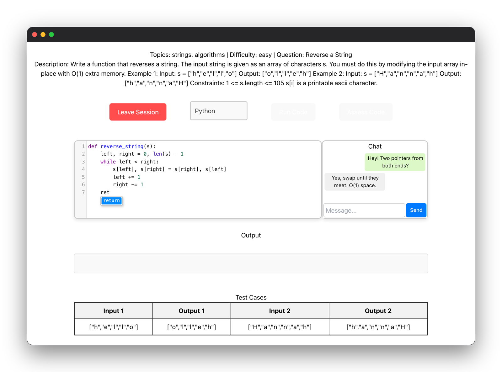
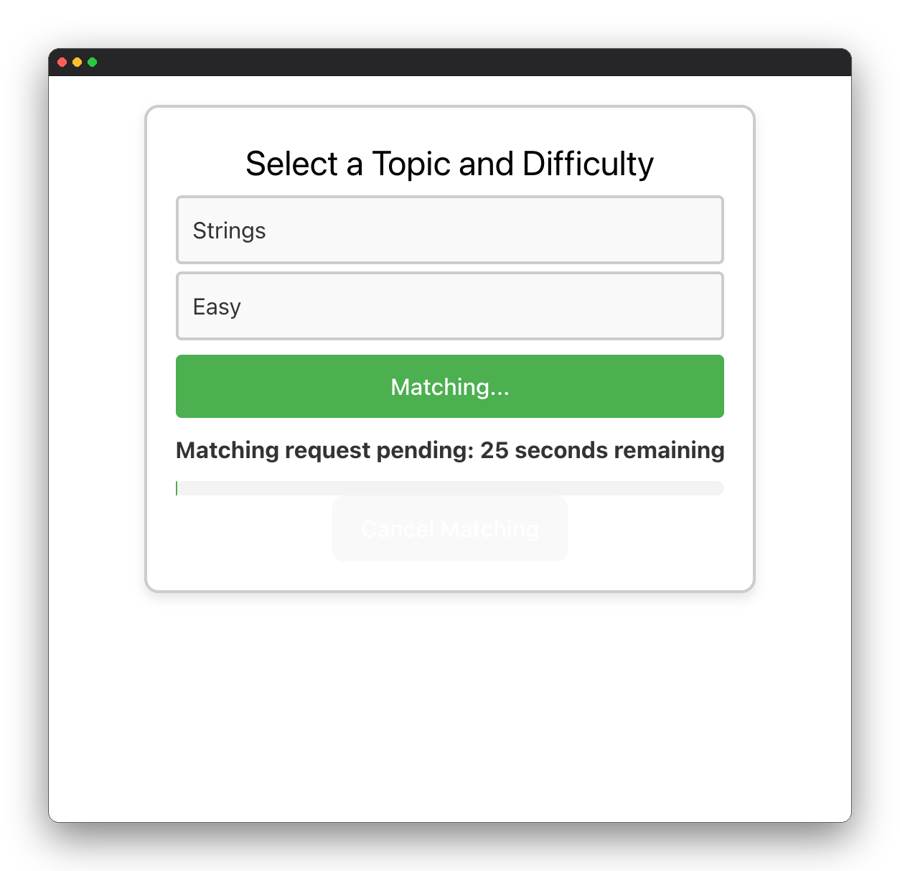
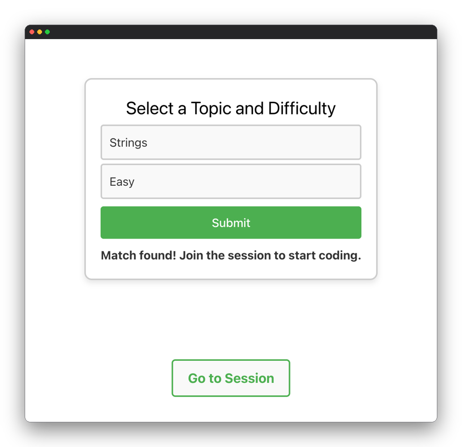
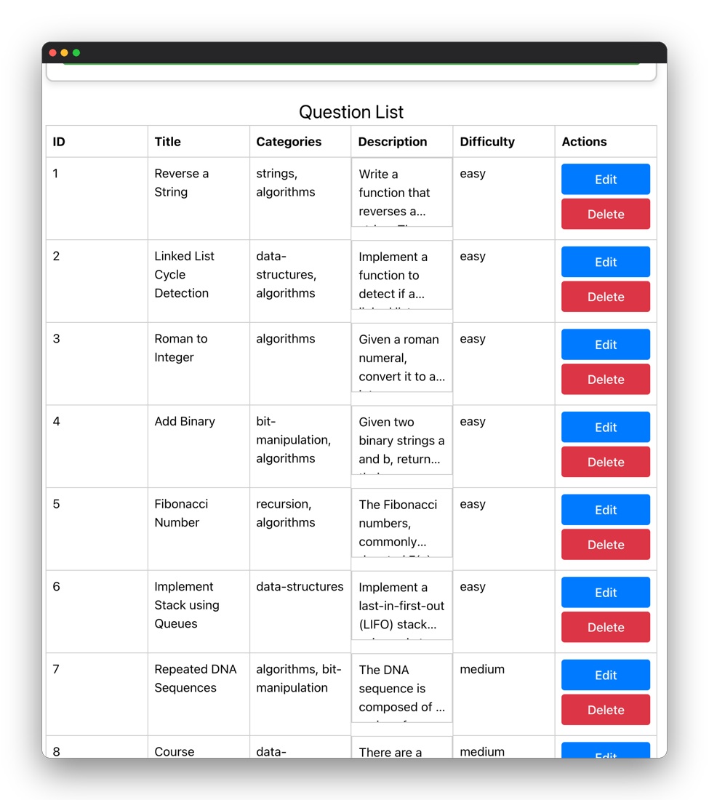
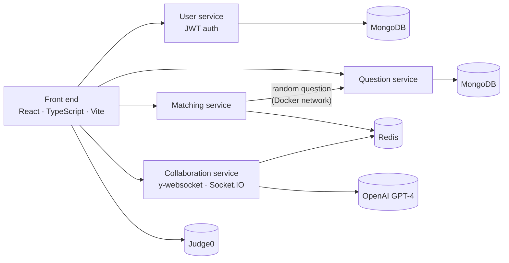
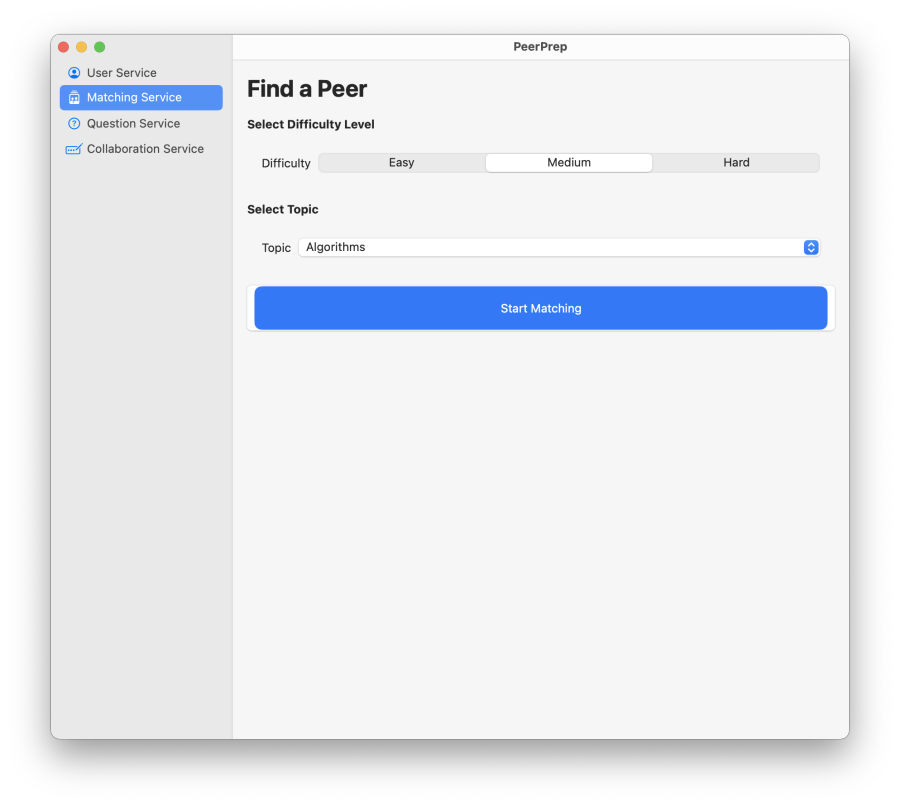

<div align="center">

# PeerPrep

**Technical-interview practice with a stranger, in real time.**<br>
Pick a topic and a difficulty, get matched with another student, and solve the same question
together in a shared code editor with chat, code execution in eight languages and AI feedback.
Built by a team of five for NUS CS3219, as four microservices behind a React front end.

[](https://github.com/sp4ce-cowboy/PeerPrep/blob/3b54cadfac2e6dd515097c149c4705e9c1cc6734/peerprep/frontend/src/views/MatchingServiceViews/MatchingServiceMainView.tsx#L5-L91)
[](https://github.com/sp4ce-cowboy/PeerPrep/blob/3b54cadfac2e6dd515097c149c4705e9c1cc6734/peerprep/frontend/src/api/matchingApi.ts#L138-L195)
[](https://github.com/sp4ce-cowboy/PeerPrep/blob/3b54cadfac2e6dd515097c149c4705e9c1cc6734/peerprep/frontend/src/views/CollabServiceViews/CollabServiceIntegratedView.tsx#L280-L306)
[](https://github.com/sp4ce-cowboy/PeerPrep/blob/3b54cadfac2e6dd515097c149c4705e9c1cc6734/peerprep/frontend/src/views/CollabServiceViews/CollabServiceIntegratedView.tsx#L95-L110)
[](https://github.com/sp4ce-cowboy/PeerPrep/blob/3b54cadfac2e6dd515097c149c4705e9c1cc6734/peerprep/frontend/src/views/CollabServiceViews/CollabServiceIntegratedView.tsx#L124-L139)
[](https://github.com/sp4ce-cowboy/PeerPrep/blob/3b54cadfac2e6dd515097c149c4705e9c1cc6734/peerprep/backend/question-service/src/controllers/questionController.ts#L103-L169)
[](https://github.com/sp4ce-cowboy/PeerPrep/blob/3b54cadfac2e6dd515097c149c4705e9c1cc6734/peerprep/backend/question-service/src/server.ts#L38-L44)
[](https://github.com/sp4ce-cowboy/PeerPrep/blob/3b54cadfac2e6dd515097c149c4705e9c1cc6734/peerprep/backend/question-service/src/controllers/questionController.ts#L123-L135)
[](https://github.com/sp4ce-cowboy/PeerPrep/blob/3b54cadfac2e6dd515097c149c4705e9c1cc6734/peerprep/backend/docker-compose.yaml#L38-L41)
[](https://github.com/sp4ce-cowboy/PeerPrep/blob/3b54cadfac2e6dd515097c149c4705e9c1cc6734/peerprep/frontend/src/styles/App.css)


[](https://wakatime.com)

</div>

> [!NOTE]
> This consolidated README page was added by
> [Claude Opus 5.5](https://docs.anthropic.com/en/docs/claude-code) in Nov 2026 using my
> [agentic-repo-analysis](https://github.com/sp4ce-cowboy/agentic-workflows) skill, from the
> project's code, git history and the team's reports. The project itself is from Aug – Nov 2024. The
> original README, the team's deployment guide, is in **[README-ORIGINAL.md](README-ORIGINAL.md)**.
> The technical write-up is in **[ARCHITECTURE.md](ARCHITECTURE.md)**.

<p align="center">
  
</p>

## At a glance

| | |
|---|---|
| **What** | A web platform for mock technical interviews: matching by topic and difficulty, a real-time collaborative editor, code execution, chat, AI code review, and a question bank |
| **Context** | NUS [CS3219](https://nusmods.com/courses/CS3219/software-engineering-principles-and-patterns) *Software Engineering Principles and Patterns*, AY2024/25 Semester 1, Aug – Nov 2024 |
| **Team** | [Kim Yongbeom](https://github.com/Yongbeom-Kim), [Bhanuka Bandara Ekanayake](https://github.com/bhnuka), [C Mahidharah Rajendran](https://github.com/Mahidharah), [Suryansh Kushwaha](https://github.com/suryanshkushwaha) and [Rubesh Suresh](https://github.com/sp4ce-cowboy) |
| **My role** | The front end across all four services; the collaboration service's design and code editor, with its multi-language enhancements; integration between services; and the Milestone 1 prototype in SwiftUI. Details in [My part](#my-part) |
| **Stack** | React, TypeScript and Vite; CodeMirror, Yjs and Socket.IO; Node.js and Express microservices; MongoDB and Redis; Judge0; OpenAI; Docker Compose; Google Cloud with Nginx |

## The course

[CS3219](https://nusmods.com/courses/CS3219/software-engineering-principles-and-patterns) is NUS's
course on software architecture: requirements, design decisions explored against alternatives, and
the patterns that make them repeatable. The whole semester builds one product, PeerPrep, in seven
milestones: a backlog and mock-up, a single-page app with REST APIs, containers, message queues and
matching, integration and collaboration, the team's choice of nice-to-haves, then a report and demo.

## Features

<p align="center">
  
  
</p>

- **Matching.** A student picks a topic and a difficulty. For 15 seconds the matching service looks
  for someone with both; after that it falls back to the topic alone, up to 30 seconds. The page
  shows a live countdown, follows the match status as the service pushes it (server-sent events),
  and offers the session as soon as a match lands.
- **A shared editor.** Both students edit one document. Yjs, a CRDT, merges their keystrokes, bound
  to a CodeMirror editor with line numbers, an undo shared by both, syntax highlighting and
  autocomplete for eight languages: C, C++, C#, Java, JavaScript, Kotlin, Python and Ruby.
- **Run the code.** One language selector switches the highlighting and the Judge0 runtime together.
  The output appears under the editor, beside the question's test cases.
- **Talk and get feedback.** A Socket.IO chat per session room, and an "Assess Code" button that asks
  GPT-4, with a fixed prompt, to review the solution for correctness, style and complexity.
- **A question bank.** Admins add, edit and delete questions with categories, difficulty and test
  cases.

<p align="center">
  
</p>
<p align="center"><sub>Captured from the final code, run locally with Docker Compose and two demo users</sub></p>

## Architecture in brief



- **Microservices, one database each.** User, question, matching and collaboration services, each
  with its own store. The one exception: matching and collaboration share Redis, since a student is
  either in a queue or in a session, never both.
- **One front end.** The views for every service live in one React app, organised per service with
  shared styling.
- **Containers.** Docker Compose runs the services on one bridge network, so they reach each other by
  service name. The cloud build ran on a Google Cloud VM, with Nginx routing by hostname.

More in [ARCHITECTURE.md](ARCHITECTURE.md): the requirements, the database and editor decisions, the
matching algorithm, the collaboration mechanism, and deployment.

## My part

From the team's final report and the git history:

- **The front end, end to end.** Every view of the user, question, matching and collaboration
  services, the routing and navigation between them, and the styling standardised across the app.
- **The collaboration service.** Its overall design, the CodeMirror editor wired to Yjs, and the
  enhancements: syntax highlighting, autocomplete and code execution for eight languages, chosen
  together from one selector.
- **Integration.** The matching page's countdown and live status; the question service's random
  question endpoint for the matching service; and the Docker bridge network plus CORS that let the
  services call each other.
- **The Milestone 1 prototype.** Before the web app, a native macOS prototype of every service's
  screens in SwiftUI ([sp4ce-cowboy/PeerPrepUIPrototype](https://github.com/sp4ce-cowboy/PeerPrepUIPrototype)).

<p align="center">
  
</p>

## Skills shown

| Skill | Where it shows (click the links for the code) | Docs |
|---|---|---|
| **Front-end development**<br> | The matching page: form, countdown, live match status and session hand-off: [`MatchingServiceMainView`](https://github.com/sp4ce-cowboy/PeerPrep/blob/3b54cadfac2e6dd515097c149c4705e9c1cc6734/peerprep/frontend/src/views/MatchingServiceViews/MatchingServiceMainView.tsx#L5-L91); routes for every service: [`App.tsx`](https://github.com/sp4ce-cowboy/PeerPrep/blob/3b54cadfac2e6dd515097c149c4705e9c1cc6734/peerprep/frontend/src/App.tsx#L23-L55) | [React](https://react.dev) |
| **Real-time collaboration**<br> | A Yjs document bound to CodeMirror through y-codemirror, over a y-websocket provider, torn down on leave: [session set-up](https://github.com/sp4ce-cowboy/PeerPrep/blob/3b54cadfac2e6dd515097c149c4705e9c1cc6734/peerprep/frontend/src/views/CollabServiceViews/CollabServiceIntegratedView.tsx#L95-L110) | [Yjs](https://docs.yjs.dev) |
| **Editor engineering**<br> | Language modes for 8 languages mapped from Judge0 IDs: [`handleLangChange`](https://github.com/sp4ce-cowboy/PeerPrep/blob/3b54cadfac2e6dd515097c149c4705e9c1cc6734/peerprep/frontend/src/views/CollabServiceViews/CollabServiceIntegratedView.tsx#L124-L139); autocomplete on keystrokes with the hint API: [editor options](https://github.com/sp4ce-cowboy/PeerPrep/blob/3b54cadfac2e6dd515097c149c4705e9c1cc6734/peerprep/frontend/src/views/CollabServiceViews/CollabServiceIntegratedView.tsx#L280-L306) | [CodeMirror 5](https://codemirror.net/5/doc/manual.html) |
| **Typed API clients**<br> | Typed clients for the matching service's session endpoints, with shared error handling: [`matchingApi.ts`](https://github.com/sp4ce-cowboy/PeerPrep/blob/3b54cadfac2e6dd515097c149c4705e9c1cc6734/peerprep/frontend/src/api/matchingApi.ts#L138-L195) | [Axios](https://axios-http.com/docs/intro) |
| **Back-end APIs**<br> | A random-question endpoint by topic and difficulty, used by the matching service: [`getRandomQuestionEndpoint`](https://github.com/sp4ce-cowboy/PeerPrep/blob/3b54cadfac2e6dd515097c149c4705e9c1cc6734/peerprep/backend/question-service/src/controllers/questionController.ts#L103-L169) | [Express](https://expressjs.com) |
| **Containers & service networking**<br> | A shared bridge network so services call each other by name: [`docker-compose.yaml`](https://github.com/sp4ce-cowboy/PeerPrep/blob/3b54cadfac2e6dd515097c149c4705e9c1cc6734/peerprep/backend/docker-compose.yaml#L38-L41); CORS on the question service: [`server.ts`](https://github.com/sp4ce-cowboy/PeerPrep/blob/3b54cadfac2e6dd515097c149c4705e9c1cc6734/peerprep/backend/question-service/src/server.ts#L38-L44) | [Compose networking](https://docs.docker.com/compose/how-tos/networking/) |
| **UI design**<br> | The app's shared styling, about 660 of its 920 lines: [`App.css`](https://github.com/sp4ce-cowboy/PeerPrep/blob/3b54cadfac2e6dd515097c149c4705e9c1cc6734/peerprep/frontend/src/styles/App.css) | [MDN CSS](https://developer.mozilla.org/en-US/docs/Web/CSS) |
| **Prototyping in SwiftUI**<br> | Milestone 1: every service's screens as a native prototype: [PeerPrepUIPrototype](https://github.com/sp4ce-cowboy/PeerPrepUIPrototype) | [SwiftUI](https://developer.apple.com/documentation/swiftui) |
| **Team workflow** | A monorepo with branch protection, feature branches and a dev branch merged to main at each milestone; 71 pull requests across the team | — |

## Coding stats

My own numbers, from git and [WakaTime](https://wakatime.com).

| | |
|---|---|
| **Time** | **38 h** of coding, over 30 days |
| **Period** | 29 Sep – 11 Nov 2024, with commits on 18 days |
| **Peak week** | **11.2 h** (28 Oct – 3 Nov 2024: the collaboration service, its editor enhancements and code execution) |
| **Peak day** | **6.4 h** (Sun 29 Sep 2024: the question bank's views wired to its REST API, for Milestone 2) |
| **Longest push** | **12.5 h** without a break longer than 3 h (Sun 10 Nov 20:51 → Mon 11 Nov 09:21), adding Kotlin, C# and Ruby before the final demo |
| **Commits** | **55** of the team's 312, and **15** merged pull requests of 59 |
| **Code** | about **1,800** lines of mine in the final code, mostly TypeScript, TSX and CSS |

```text
My hours per week (2024)               My commits per month
23 Sep  ████████████            6.6    2024-09  ████████████         16
30 Sep  █                       0.3    2024-10  ████████████         17
07 Oct  █                       0.6    2024-11  ████████████████     22
14 Oct  ████                    2.4
21 Oct  ████████████████        9.0
28 Oct  ████████████████████   11.2
04 Nov  ██████████              5.8
11 Nov  ███                     1.9
```

## On my resume

**Skills:** React · TypeScript · real-time collaboration (Yjs CRDTs, WebSockets) · CodeMirror · REST APIs · server-sent events · Node.js and Express · MongoDB · Docker Compose · microservices · CSS · SwiftUI prototyping · team development (5 developers)

- Built the front end of PeerPrep, a microservices platform for mock technical interviews, in React and TypeScript for a team of five: every view of the user, question, matching and collaboration services, the routing between them and a shared design system.
- Designed the collaborative coding session: a CodeMirror editor bound to a Yjs CRDT document through y-codemirror and y-websocket, so two students edit the same code with a shared undo history.
- Added syntax highlighting, keystroke-triggered autocomplete and code execution for 8 languages (C, C++, C#, Java, JavaScript, Kotlin, Python, Ruby) behind one selector that maps each language to both its CodeMirror mode and its Judge0 runtime.
- Built the matching experience: topic and difficulty selection, a 30-second countdown with a progress bar, the matching service's live status, and a hand-off into the shared session.
- Integrated the services: a random-question endpoint by topic and difficulty in the question service (Express, MongoDB), consumed by the matching service over a Docker bridge network, with CORS configured between services.
- Prototyped all four services' screens as a native macOS app in SwiftUI for the first milestone, before the web build.

## Getting started

The services need their own `.env` files (MongoDB and Redis URIs, a JWT secret, and optional OpenAI
and Judge0 keys); see [README-ORIGINAL.md](README-ORIGINAL.md) for the team's deployment tooling.

```sh
cd peerprep/backend && docker compose up --build   # user, question, matching and collaboration services
cd peerprep/frontend && npm install && npm run dev # the app, on http://localhost:5173
```
